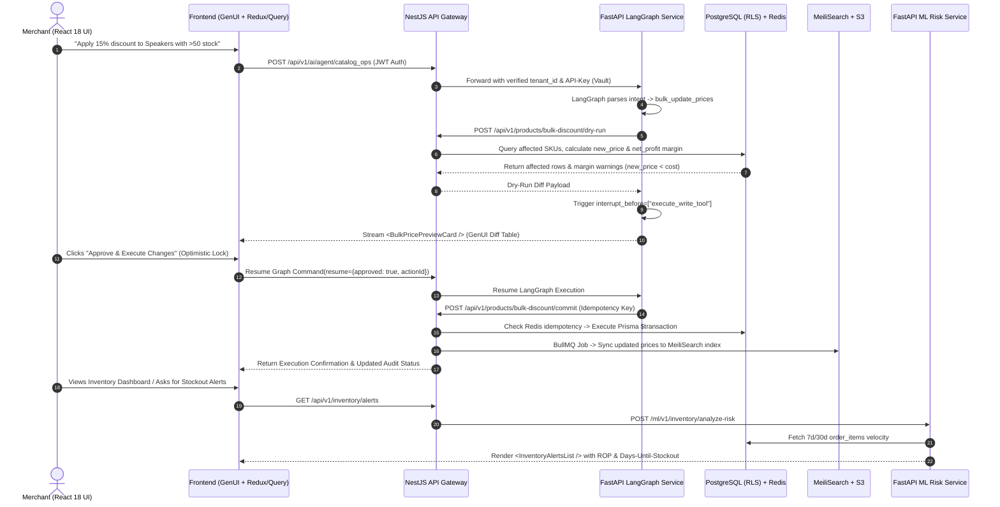

# Adel — Full Implementation Plan & Technical Specification

> **Slice Owner:** Adel (عادل)  
> **Role:** Autonomous Catalog, Inventory & Human-in-the-Loop (HITL) Operations Lead  
> **Arabic Title:** الإدارة الذاتية للمنتجات والمخزون ونظام المعاينة والتأكيد (HITL)  
> **System Design Alignment:** Sections 3.2, 4.3, 5.1–5.6, 6, 7.2, 7.7, 8–12  
> **Date:** 2026-10-21  

---

## 1. Executive Summary & Vertical Slice Scope

Within **Project-AI (TechZone)**, Adel owns the end-to-end **Catalog, Inventory & Human-in-the-Loop (HITL) Operations** vertical slice across all five engineering layers. This slice enables merchants to manage products and inventory autonomously via natural language (e.g., *"Add a 15% discount to all products in the speakers category with > 50 units in stock"*) while enforcing strict **Human-in-the-Loop (HITL)** visual confirmation, atomic database transactions, margin safety guardrails, and probabilistic stockout predictions.

### Core Architectural Guarantees (Per System Design)
| Pillar | System Design Standard Applied to Adel's Slice |
| :--- | :--- |
| **Multi-Tenant Isolation** | PostgreSQL Row-Level Security (RLS) via `app.current_tenant_id` / `app.tenant_id` session variables and per-tenant schema scoping. |
| **Latency & Throughput Budgets** | $< 200\text{ ms}$ average latency for Catalog/Inventory REST API calls; $< 500\text{ ms}$ for AI Agent dry-run preview generation; scaled for $10\text{ k}$ RPS peak. |
| **Caching & Idempotency** | Redis caching ($\text{TTL} = 60\text{ s}$) for read-heavy catalog endpoints (`GET /api/v1/products`) and Redis idempotency locks (`idempotency:action:{action_id}`) for bulk write mutations. |
| **Search Synchronization** | Sub-$50\text{ ms}$ bilingual (Arabic/English) typo-tolerant search via MeiliSearch synced with PostgreSQL via Change-Data-Capture (CDC) / BullMQ domain events. |
| **Observability & Compliance** | Prometheus `/metrics` scraping, OpenTelemetry spans, ELK structured JSON logs, and Langfuse traces (`trace_id`, `step_name`, `duration`) for every tool call and HITL interrupt. |
| **Testing Coverage** | $\ge 90\%$ unit/integration test coverage across Jest, React Testing Library, Supertest, pytest, and Cypress E2E flows. |

---

## 2. Slice Architecture & HITL Execution Flow

---

## 3. Five Engineering Layers Implemented

### Layer 1: Frontend & Generative UI (React 18)
- `<BulkPricePreviewCard />`: Displays structured diff table with SKU, Current Price, Proposed Price, Unit Cost, New Margin %, and highlight flags for negative margins. Features optimistic lock on approval button and LangGraph resume payload dispatch.
- `<ProductUpdatePreviewCard />`: Single product update preview card.
- `<InventoryAlertsList />`: Dynamic ROP alerts, Days-Until-Stockout badges, and financial impact ranking.
- `ProductsGridPage.tsx`: Merchant catalog management grid with MeiliSearch instant search and S3 presigned upload dropzone.
- `catalogSlice.ts`: Redux Toolkit slice for filtering, selection, and optimistic updates.
- Bilingual i18n support in `apps/web/src/locales/ar/catalog.json` and `apps/web/src/locales/en/catalog.json`.

### Layer 2: Backend API Layer (NestJS)
- `ProductsController` & `ProductsService` (`apps/api/src/products/`):
  - `GET /api/v1/products`: Redis cached (`TTL = 60s`).
  - `PATCH /api/v1/products/:id`: Atomic update and cache invalidation.
  - `POST /api/v1/products/bulk-discount/dry-run`: Read-only preview without committing changes.
  - `POST /api/v1/products/bulk-discount/commit`: Atomic Prisma `$transaction` across 1,000+ SKUs with Redis 24h idempotency lock (`idempotency:action:{actionId}`).
  - `POST /api/v1/products/media/presign`: S3 presigned upload URL generator.
- `InventoryController` & `InventoryService` (`apps/api/src/inventory/`):
  - `GET /api/v1/inventory/alerts`: Prioritized stockout risk alerts and recommended reorder quantities.
- `MeilisearchSyncProcessor` (`apps/api/src/jobs/meilisearch-sync.processor.ts`):
  - Asynchronous BullMQ background indexing.

### Layer 3: Database & Security Layer (PostgreSQL RLS & MeiliSearch)
- `schema.prisma`:
  - `Category` model (`categories` table) with hierarchical parent-child relations.
  - `Product` model with `cost`, `price`, and `metadata` JSONB.
  - `Inventory` model with `tenant_id`, `quantity`, and `reorder_level`.
- `catalog_rls_and_constraints.sql`:
  - CHECK constraints: `CHECK (price >= 0)`, `CHECK (cost >= 0)`, `CHECK (quantity >= 0)`.
  - Composite B-Tree indexes: `(tenant_id, category_id, is_active)` and `(tenant_id, sku)`.
  - PostgreSQL Row-Level Security policies enforcing `app.current_tenant_id` / `app.tenant_id`.
- `packages/search/meilisearch_config.json`:
  - Full bilingual Arabic/English search index configuration with typo tolerance and synonyms.

### Layer 4: AI Agent & LLM Orchestration Layer (LangGraph)
- `catalog_tools.py` (`apps/agent/tools/`):
  - `search_products`, `get_inventory_alerts`, `update_product`, `bulk_update_prices`.
- `hitl_gate_node.py` (`apps/agent/nodes/`):
  - Dry-run preview calculation, Margin Safety Guardrail (`new_price < cost`), Langfuse trace logging, and `interrupt()`.
- `catalog_agent_graph.py` (`apps/agent/graphs/`):
  - Full StateGraph workflow with `MemorySaver` checkpointer and resumption via `Command(resume=...)`.

### Layer 5: Machine Learning & Data Science Layer (Python)
- `stockout_optimizer.py` (`apps/ml/src/inventory/`):
  - Rolling mean demand ($\mu_d$), standard deviation ($\sigma_d$), and EWMA demand velocity.
  - Probabilistic Safety Stock: $\text{SS} = 1.645 \cdot \sigma_d \sqrt{L}$.
  - Dynamic Reorder Point: $\text{ROP} = (\mu_d \times L) + \text{SS}$.
  - Days-Until-Stockout: $\text{DUS} = \frac{Q_{\text{current}}}{\max(\text{EWMA}_d, \epsilon)}$.
  - Daily Profit at Risk: $\text{EWMA}_d \times (\text{price} - \text{cost})$.
- `inventory_risk.py` router:
  - `POST /ml/v1/inventory/analyze-risk`.
