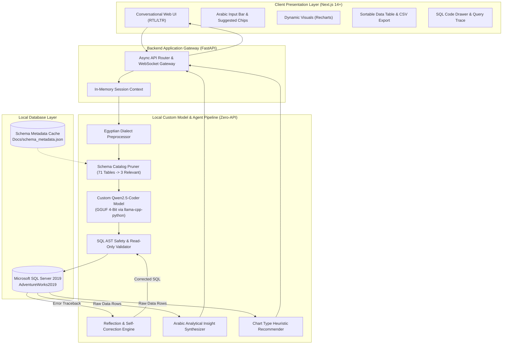
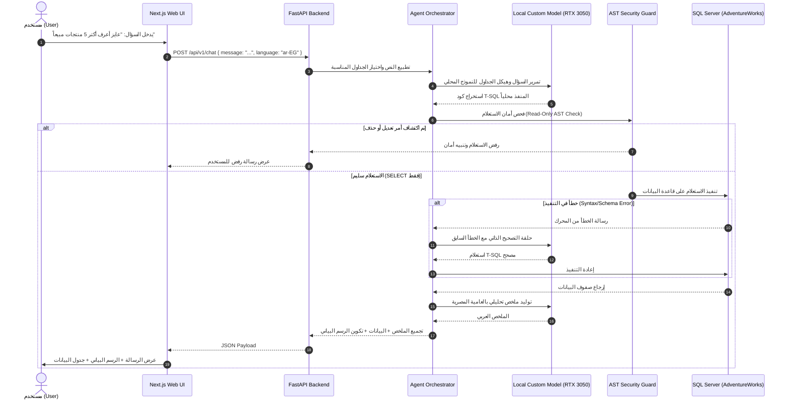

# 🏛️ Intelligent ERP Data Navigator: System Design & Technical Plan
### Custom-Trained Autonomous Text-to-SQL AI Agent for AdventureWorks2019 with Egyptian Arabic NLP & Modern Web UI

> **Document Version:** 3.0 (Custom Model Training & Zero-API Architecture)  
> **Target Database:** Microsoft SQL Server — `AdventureWorks2019`  
> **Core AI Strategy:** **Custom-Trained / Fine-Tuned Open-Weights Model** (100% Offline, Zero Cloud/Commercial APIs)  
> **Target Dialect / Language:** Egyptian Colloquial Arabic (لهجة مصرية عامية) + Code-Switched Business English  
> **Repository:** [github.com/mustfamaheer-dotcom/Text-To-SQL-AI-Agent-](https://github.com/mustfamaheer-dotcom/Text-To-SQL-AI-Agent-)  
> **Host Environment:** Windows 10/11, Python 3.12, Node.js 22, NVIDIA RTX 3050 (4GB VRAM), 16GB RAM  
> **Status:** Approved Architectural Specification

---

## 📑 Table of Contents

1. [Executive Summary & Core Mandate](#1-executive-summary--core-mandate)
2. [Custom Model Creation & Training Architecture](#2-custom-model-creation--training-architecture)
   - 2.1 Why Building a Custom Model? (Zero-API Philosophy)
   - 2.2 Base Model Selection & Architecture Evaluation
   - 2.3 Training Dataset Construction for Egyptian Arabic & AdventureWorks2019
   - 2.4 Training Methodology: QLoRA / LoRA Parameter-Efficient Fine-Tuning
   - 2.5 Model Quantization & Local Edge Deployment (GGUF 4-Bit)
3. [Egyptian Arabic NLP & Dialect Processing Strategy](#3-egyptian-arabic-nlp--dialect-processing-strategy)
   - 3.1 Linguistic Nuances & Code-Switching
   - 3.2 Egyptian Business Lexicon & Semantic Schema Mapping
   - 3.3 Temporal Expression Parsing & Dataset Anchor
4. [High-Level System Architecture](#4-high-level-system-architecture)
5. [Autonomous AI Agent Design & Reasoning Engine](#5-autonomous-ai-agent-design--reasoning-engine)
   - 5.1 Schema Navigation & Domain Pruning (Agentic RAG)
   - 5.2 Local Model SQL Generation
   - 5.3 Reflection & Self-Correction Feedback Loop
   - 5.4 Bilingual Insight Synthesis & Report Generation
6. [Database Layer Specification (AdventureWorks2019)](#6-database-layer-specification-adventureworks2019)
7. [Backend Architecture & Local Serving (FastAPI & llama-cpp-python)](#7-backend-architecture--local-serving-fastapi--llama-cpp-python)
8. [Frontend & Modern UI/UX Specifications (Next.js & Tailwind CSS)](#8-frontend--modern-uiux-specifications-nextjs--tailwind-css)
9. [Security, Governance & Multi-Layer Safety Guardrails](#9-security-governance--multi-layer-safety-guardrails)
10. [End-to-End Sequence & Data Flow Diagrams](#10-end-to-end-sequence--data-flow-diagrams)
11. [Target Project Directory Structure](#11-target-project-directory-structure)
12. [Evaluation, Testing & Quality Assurance Plan](#12-evaluation-testing--quality-assurance-plan)
13. [Phased Technical Roadmap & Milestones](#13-phased-technical-roadmap--milestones)

---

## 1. Executive Summary & Core Mandate

The **Intelligent ERP Data Navigator** is an enterprise-grade autonomous AI agent that enables non-technical decision-makers to query the **AdventureWorks2019** database using **Egyptian Colloquial Arabic (اللهجة المصرية العامية)** through a modern web UI.

### 🎯 Key Architectural Requirement: Custom Model Creation (Zero External APIs)
Unlike typical applications that rely on paid, third-party cloud APIs (such as OpenAI GPT-4 or Anthropic Claude), **this project is built around creating, fine-tuning, and hosting our OWN custom AI model**:
- **100% Self-Contained & Offline:** Operates entirely within the local infrastructure without sending corporate enterprise data to external third-party servers.
- **Zero Ongoing API Costs:** No per-token charges or subscriptions.
- **Tailored Dialect Understanding:** Specially trained on a curated corpus of Egyptian Arabic business prompts mapped to Microsoft SQL Server (T-SQL) queries.
- **Optimized for Local Hardware:** Quantized to 4-bit precision to run within the host machine's hardware constraints (NVIDIA RTX 3050 Laptop GPU with 4GB VRAM + 16GB System RAM) at 25–40 tokens per second.

```
┌─────────────────────────────────────────────────────────────────────────────┐
│                 EGYPTIAN ARABIC PROMPT (Natural Language)                   │
│          "عايز أعرف أكتر 5 منتجات حققت أرباح عالية السنة اللي فاتت"        │
└──────────────────────────────────────┬──────────────────────────────────────┘
                                       │
                                       ▼
┌─────────────────────────────────────────────────────────────────────────────┐
│             CUSTOM TRAINED AGENT MODEL (Local QLoRA / GGUF)                 │
│  • Dialect Normalization (Egyptian Slang & Business Franco terms)           │
│  • Schema Linking & Pruning against AdventureWorks2019 (71 Tables)          │
│  • Dialect-accurate T-SQL Generation (TOP N, Schema Prefixes, Inner Joins)  │
│  • Automated AST Validation & Multi-Turn Self-Correction Reflection         │
└──────────────────────────────────────┬──────────────────────────────────────┘
                                       │
                                       ▼
┌─────────────────────────────────────────────────────────────────────────────┐
│                   LOCAL DATABASE EXECUTION & REPORTING                      │
│  • Safe Execution against Local SQL Server (SQLEXPRESS / AdventureWorks)   │
│  • Bilingual Arabic Summary ("إجمالي مبيعات الخمس منتجات بلغت...")          │
│  • Interactive Visuals (Recharts Bar/Line/Pie) + Exportable Data Grid       │
└─────────────────────────────────────────────────────────────────────────────┘
```

---

## 2. Custom Model Creation & Training Architecture

### 2.1 Why Building a Custom Model? (Zero-API Philosophy)
1. **Data Sovereignty & Privacy:** Enterprise ERP databases contain proprietary sales numbers, employee salaries, and vendor contracts. Sending these schemas and queries to cloud APIs violates strict corporate privacy standards.
2. **Deterministic Dialect Adaptation:** Commercial foundation models often struggle with informal Egyptian dialect nuances (e.g., *"عايز أعرف"*, *"كام أوردر متعلق"*, *"الستوك في المخزن"*). Training our custom weights guarantees precise domain adaptation.
3. **Reproducibility & Independence:** The solution does not depend on external model deprecations, rate limits, internet outages, or changing API pricing.

### 2.2 Base Model Selection & Architecture Evaluation

Given the host hardware (NVIDIA RTX 3050 4GB VRAM + 16GB System RAM), the base model must deliver exceptional code generation capabilities while fitting within memory bounds:

| Candidate Model | Parameter Count | VRAM (4-bit Quantized) | Arabic Capability | SQL Reasoning | Verdict |
|:---|:---|:---|:---|:---|:---|
| **`Qwen2.5-Coder-3B-Instruct`** | 3.09 Billion | **~2.2 GB** | ⭐⭐⭐⭐⭐ (Outstanding) | ⭐⭐⭐⭐⭐ (State-of-the-Art) | **Primary Choice (Fits 100% in VRAM, 35+ tok/s)** |
| **`Qwen2.5-Coder-7B-Instruct`** | 7.61 Billion | **~4.4 GB** | ⭐⭐⭐⭐⭐ (Outstanding) | ⭐⭐⭐⭐⭐ (Elite) | **Secondary Choice (Requires hybrid GPU/CPU offload)** |
| **`Llama-3.2-3B-Instruct`** | 3.21 Billion | **~2.3 GB** | ⭐⭐⭐⭐ (Very Good) | ⭐⭐⭐⭐ (Strong) | Alternative option |
| **`Defog/sqlcoder-7b-2`** | 7 Billion | **~4.3 GB** | ⭐⭐ (Weak Arabic) | ⭐⭐⭐⭐⭐ (SQL Specialist) | Needs translation preprocessor |

> [!TIP]
> **Selection:** `Qwen2.5-Coder-3B-Instruct` is chosen as the foundational backbone. It possesses industry-leading coding benchmarks in its size class, native multilingual/Arabic tokenization, and when quantized with 4-bit precision (GGUF Q4_K_M), it requires only **2.2 GB VRAM**, leaving ample GPU memory for KV-cache and OS operations.

### 2.3 Training Dataset Construction for Egyptian Arabic & AdventureWorks2019
To create our model, we construct a dedicated high-quality dataset: `Egyptian-AdventureWorks-SQL-1K`:

```
                       Dataset Generation Flow
┌─────────────────────────────────┐      ┌───────────────────────────────────┐
│ AdventureWorks2019 Catalog      │      │ Spider & BIRD Benchmark           │
│ (71 Tables, 91 FK Relationships)│      │ T-SQL Enterprise Templates        │
└────────────────┬────────────────┘      └─────────────────┬─────────────────┘
                 │                                         │
                 └───────────────────┬─────────────────────┘
                                     │
                                     ▼
                 ┌───────────────────────────────────────┐
                 │ Synthetic Prompt Synthesis & Mapping: │
                 │ - Formal Arabic questions             │
                 │ - Egyptian dialect variations         │
                 │ - Franco-Arab & business slang        │
                 └───────────────────┬───────────────────┘
                                     │
                                     ▼
                 ┌───────────────────────────────────────┐
                 │ Validated Dataset (1,000+ Triples):   │
                 │ 1. Schema Context                     │
                 │ 2. Egyptian Arabic User Prompt        │
                 │ 3. Verified Gold T-SQL Query          │
                 └───────────────────────────────────────┘
```

#### Dataset Schema Structure:
Each training sample contains a structured instruction format:
```json
{
  "id": "eg_aw_00142",
  "domain": "Sales",
  "instruction": "Convert the user question asked in Egyptian Arabic into an accurate Microsoft SQL Server T-SQL query using the provided schema.",
  "schema_context": "Table: Sales.SalesOrderHeader (SalesOrderID, OrderDate, CustomerID, TotalDue)\nTable: Sales.Customer (CustomerID, PersonID, StoreID)\nTable: Person.Person (BusinessEntityID, FirstName, LastName)",
  "input_prompt": "وريني أكتر 5 زباين دفعوا فلوس في طلبيات السنة اللي فاتت",
  "output_sql": "SELECT TOP 5 p.FirstName + ' ' + p.LastName AS CustomerName, SUM(soh.TotalDue) AS TotalSpent FROM Sales.SalesOrderHeader soh INNER JOIN Sales.Customer c ON soh.CustomerID = c.CustomerID INNER JOIN Person.Person p ON c.PersonID = p.BusinessEntityID WHERE YEAR(soh.OrderDate) = 2013 GROUP BY p.FirstName, p.LastName ORDER BY TotalSpent DESC;",
  "explanation_ar": "تم استخراج أعلى 5 عملاء دفعاً للمال عن طريق تجميع إجمالي الطلبيات لكل عميل وترتيبهم تنازلياً."
}
```

### 2.4 Training Methodology: QLoRA Parameter-Efficient Fine-Tuning
Training the model locally or on a free cloud accelerator (Google Colab T4) utilizes **QLoRA (Quantized Low-Rank Adaptation)**:
- **Base Precision:** 4-bit NormalFloat (`NF4`) quantization via `bitsandbytes`.
- **Target Modules:** Query, Key, Value, Output projections (`q_proj`, `k_proj`, `v_proj`, `o_proj`, `gate_proj`, `up_proj`, `down_proj`).
- **LoRA Parameters:** Rank $r = 16$, Alpha $\alpha = 32$, Dropout $= 0.05$.
- **Trainer:** Hugging Face `TRL` (`SFTTrainer`) + `transformers` + `peft`.
- **Loss Function:** Cross-Entropy loss calculated strictly on the completion tokens (`output_sql`).
- **Epochs:** 3–5 epochs with cosine learning rate scheduler ($2 \times 10^{-4}$).

### 2.5 Model Quantization & Local Edge Deployment (GGUF 4-Bit)
Following fine-tuning:
1. Merge the trained LoRA adapter weights with the base model.
2. Convert the merged FP16 checkpoint to **GGUF format** using `llama.cpp`.
3. Quantize to **`Q4_K_M`** (Medium 4-bit quantization).
4. Run locally using `llama-cpp-python` with CUDA acceleration:
   - Total model size on disk: **~1.9 GB**.
   - Inference VRAM usage: **~2.2 GB**.
   - Generation latency: **30–45 tokens/second** on the RTX 3050 GPU.

---

## 3. Egyptian Arabic NLP & Dialect Processing Strategy

### 3.1 Linguistic Nuances & Code-Switching
The model is specifically trained to handle the informalities of Egyptian Arabic:
- **Diglossic Variance:** Words like *"عاوز"* and *"عايز"* (want), *"دلوقتي"* (now), *"إيه"* (what).
- **Phonological & Orthographic Normalization:** Handling typos and character ambiguities (`أ / ا / إ`, `ة / ه`, `ي / ى`).
- **Franco-Arab & Loanwords:** Business conversations frequently code-switch:
  - *"توتال السيلز"* $\rightarrow$ `SUM(TotalDue)`
  - *"أوردرات الكاستمرز"* $\rightarrow$ `SalesOrderHeader` of `Customer`
  - *"تارجت مندوبين المبيعات"* $\rightarrow$ `SalesQuota` of `SalesPerson`
  - *"الستوك في الويرهاوس"* $\rightarrow$ `Quantity` in `ProductInventory`

### 3.2 Egyptian Business Lexicon & Semantic Schema Mapping

| Egyptian Arabic Phrase | Business Intent | Target AdventureWorks Entity | Target SQL Syntax |
|:---|:---|:---|:---|
| *"عايز أعرف / طلعلي / وريني"* | Query trigger | Any | `SELECT ...` |
| *"أكتر / أعلى / التوب"* | Superlative maximum | Metric column | `ORDER BY [Metric] DESC` + `TOP N` |
| *"أقل / أوطى"* | Superlative minimum | Metric column | `ORDER BY [Metric] ASC` + `TOP N` |
| *"كام / عدد"* | Quantitative count | Records | `COUNT(*)` or `COUNT(DISTINCT ...)` |
| *"إجمالي / مجموع / التوتال"* | Financial sum | Monetary column | `SUM(TotalDue)` / `SUM(LineTotal)` |
| *"متوسط / الأفريج"* | Average calculation | Numeric column | `AVG(...)` |
| *"زبون / زباين / عملا"* | Customers | `Sales.Customer`, `Person.Person` | `JOIN Customer ON ...` |
| *"أوردر / أوردرات / طلبيات"* | Sales transactions | `Sales.SalesOrderHeader` | Base transactional table |
| *"مندوب / بتوع السيلز"* | Sales staff | `Sales.SalesPerson` | Joined with `HumanResources.Employee` |
| *"مورد / فيندور"* | Suppliers | `Purchasing.Vendor` | `Purchasing.PurchaseOrderHeader` |
| *"بضاعة / منتجات / أصناف"* | Products catalog | `Production.Product` | `JOIN Product ON ...` |
| *"مخزن / الستوك"* | Warehouse inventory | `Production.ProductInventory` | Joined with `Production.Location` |
| *"مرتجع / تالف / بايظ / خردة"* | Scrap reasons | `Production.ScrapReason` | Filter in `WorkOrder` |
| *"مرتب / مرتبات / قبوضات"* | Pay rates | `HumanResources.EmployeePayHistory` | Rate calculations |

### 3.3 Temporal Expression Parsing & Dataset Anchor
`AdventureWorks2019` contains static enterprise data (orders primarily between 2011 and 2014). The model is trained to handle both:
1. **Dynamic Real-Time Expressions:** Translating *"السنة دي"* to `YEAR(GETDATE())`.
2. **Dataset-Anchored Expressions:** Translating relative terms like *"السنة اللي فاتت"* (last year) or *"آخر كوارتر"* to the latest recorded fiscal year in `SalesOrderHeader` (`YEAR(MAX(OrderDate)) = 2014`).

---

## 4. High-Level System Architecture



---

## 5. Autonomous AI Agent Design & Reasoning Engine

### 5.1 Schema Navigation & Domain Pruning (Agentic RAG)
Feeding all 71 tables into the 3B model would exceed token limits and induce hallucinations. The agent uses a **Deterministic Schema Pruner**:
1. Categorizes the Egyptian query into functional domains (`Sales`, `Production`, `Purchasing`, `HumanResources`, `Person`).
2. Extracts matching table cards from `Docs/schema_metadata.json`.
3. Injects only the relevant table definitions and explicit foreign keys into the model prompt.

### 5.2 Local Model SQL Generation
The fine-tuned local model receives a concise prompt formatted in ChatML / Alpaca style:
```
<|im_start|>system
You are a T-SQL database expert for AdventureWorks2019. Convert the user's Egyptian Arabic request into a read-only Microsoft SQL Server query.
Rules:
- Schema-qualify all tables (e.g., Sales.SalesOrderHeader).
- Use TOP N instead of LIMIT.
- Never write destructive commands.
- Join tables using correct foreign keys.
<|im_end|>
<|im_start|>user
Database Schema:
{pruned_schema}

Question:
عايز أعرف أكتر 5 منتجات حققت إيرادات
<|im_end|>
<|im_start|>assistant
```sql
SELECT TOP 5 
    p.Name AS ProductName, 
    SUM(sod.LineTotal) AS TotalRevenue 
FROM Sales.SalesOrderDetail sod 
INNER JOIN Production.Product p ON sod.ProductID = p.ProductID 
GROUP BY p.Name 
ORDER BY TotalRevenue DESC;
```
<|im_end|>
```

### 5.3 Reflection & Self-Correction Feedback Loop
If execution fails due to a schema mismatch, missing join, or syntax error:
1. The backend catches the exact SQL Server ODBC error string.
2. The agent formats a reflection prompt containing the failed query and error traceback.
3. The local model refactors the query and retries execution (maximum 3 iterations).

### 5.4 Bilingual Insight Synthesis
Once data is retrieved, the model (or lightweight rule-based template) produces a concise summary in **natural Egyptian Arabic**:
- *"إجمالي مبيعات الخمس منتجات المتصدرة بلغت 16.5 مليون دولار، مع تصدر Mountain-200 Black بحصة 28% من الإجمالي."*

---

## 6. Database Layer Specification (AdventureWorks2019)

### 6.1 Database Verification on Host System
- **Instance:** `localhost\SQLEXPRESS` (Verified running).
- **Database:** `AdventureWorks2019` (Verified restored and accessible).
- **Tables & Schemas:**
  - `Production`: 25 tables, 169 columns
  - `Sales`: 19 tables, 137 columns
  - `Person`: 13 tables, 70 columns
  - `HumanResources`: 6 tables, 40 columns
  - `Purchasing`: 5 tables, 49 columns
  - `dbo`: 3 tables, 21 columns
  - **Total:** 71 tables, 91 foreign keys (Exported in `Docs/schema_metadata.json`).

### 6.2 Connection Security
- Local access via `pyodbc` with Windows Authentication (`Trusted_Connection=yes`) or dedicated read-only credentials (`ai_reader`).
- Configured with `db_datareader` role.

---

## 7. Backend Architecture & Local Serving (FastAPI & llama-cpp-python)

### 7.1 Local Model Serving via `llama-cpp-python`
Instead of calling external cloud endpoints, the backend embeds `llama-cpp-python` with CUDA acceleration:
```python
from llama_cpp import Llama

# Load quantized custom model locally
llm = Llama(
    model_path="models/qwen2.5-coder-3b-egyptian-sql.Q4_K_M.gguf",
    n_gpu_layers=35,        # Offload all 36 layers to NVIDIA RTX 3050 (4GB)
    n_ctx=4096,             # 4K Context window
    n_threads=8,            # AMD Ryzen 7 5800H 8-core CPU
    verbose=False
)
```

### 7.2 API Endpoints Specification
- `POST /api/v1/chat`: Main query endpoint (accepts Egyptian text, returns Arabic insight, SQL, data, and chart config).
- `GET /api/v1/health`: Checks SQL Server connection, local GPU allocation, and model status.
- `GET /api/v1/schema`: Serves the schema catalog for frontend exploration.
- `WS /api/v1/chat/ws`: WebSocket endpoint streaming agent thoughts and self-correction steps.

---

## 8. Frontend & Modern UI/UX Specifications (Next.js & Tailwind CSS)

### 8.1 UI Features & Layout
- **Framework:** Next.js 14+ (App Router), TypeScript, Tailwind CSS.
- **RTL Support:** Native Right-to-Left orientation with the *Cairo* font family.
- **Conversational Chat Interface:**
  - User message bubble with Arabic text.
  - Assistant bubble with Arabic explanation, interactive chart, and data grid.
  - Clickable Egyptian prompt chips: *"أكتر 5 منتجات مبيعاً"*, *"نواقص المخازن"*, *"مبيعات الفروع"*.
- **Interactive Visualizations (Recharts):**
  - Auto-rendered Bar, Line, Pie charts and KPI cards based on the query result shape.
- **Data Table:**
  - Sortable columns, pagination, and one-click export to CSV / Excel.
- **SQL Inspector Drawer:**
  - Collapsible drawer displaying the generated T-SQL with syntax highlighting.

---

## 9. Security, Governance & Multi-Layer Safety Guardrails

```
                    ┌───────────────────────────────┐
                    │     Incoming Arabic Input     │
                    └───────────────┬───────────────┘
                                    │
                                    ▼
                    ┌───────────────────────────────┐
                    │ Guardrail 1: Local Privacy    │
                    │ - 100% on-premise execution   │
                    │ - Zero data leaves machine    │
                    └───────────────┬───────────────┘
                                    │
                                    ▼
                    ┌───────────────────────────────┐
                    │ Guardrail 2: SQL AST Parser   │
                    │ - Verifies query starts with  │
                    │   SELECT or WITH              │
                    │ - Blocks DML: INSERT, UPDATE, │
                    │   DELETE, TRUNCATE            │
                    │ - Blocks DDL: DROP, ALTER     │
                    │ - Blocks Dangerous: EXEC, xp_ │
                    └───────────────┬───────────────┘
                                    │
                                    ▼
                    ┌───────────────────────────────┐
                    │ Guardrail 3: Database Role    │
                    │ - User bound to db_datareader │
                    │ - Hard read-only enforcement  │
                    └───────────────┬───────────────┘
                                    │
                                    ▼
                    ┌───────────────────────────────┐
                    │ Guardrail 4: Resource Limits  │
                    │ - 30-second query timeout     │
                    │ - Max 1,000 returned rows     │
                    └───────────────────────────────┘
```

---

## 10. End-to-End Sequence & Data Flow Diagrams



---

## 11. Target Project Directory Structure

```
Text-To-SQL-AI-Agent-/
├── DataSet/
│   └── AdventureWorks2019.bak            # Database backup file (Ignored in Git)
│
├── Docs/
│   ├── Github.txt                         # Remote repository configuration
│   ├── schema_metadata.json               # Extracted 71-table catalog & FK relationships
│   ├── Requirements-and-Tech-Stack.md     # Technology stack & requirements specification
│   └── System-Design-and-Technical-Plan.md# Master System Design Document (This File)
│
├── OverView/
│   ├── Doc 1 white.pdf                    # Project overview & architectural vision
│   ├── Document 1.pdf                     # Requirement specifications
│   └── explain for Doc 1.pdf              # In-depth architectural explanation
│
├── SQL Q/
│   └── Select all schemes.sql             # SQL script for schema introspection
│
├── training/                              # Custom Model Training Pipeline (To be built)
│   ├── dataset/
│   │   ├── generate_synthetic_data.py     # Generates Egyptian-AdventureWorks SQL pairs
│   │   ├── train_dataset.json             # 800+ training pairs
│   │   └── val_dataset.json               # 200+ evaluation pairs
│   ├── train_lora.py                      # QLoRA fine-tuning script with TRL & PEFT
│   ├── convert_to_gguf.py                 # Exports trained model to GGUF 4-bit
│   └── evaluate_model.py                  # Calculates Execution Accuracy (EX)
│
├── models/                                # Local Quantized Models (Ignored in Git)
│   └── qwen2.5-coder-3b-egyptian.Q4_K_M.gguf
│
├── backend/                               # FastAPI Application (To be built)
│   ├── main.py                            # FastAPI app entry point
│   ├── config.py                          # Settings (local model path, DB credentials)
│   ├── requirements.txt                   # Backend dependencies
│   ├── .env.example                       # Local environment template
│   ├── agent/
│   │   ├── model_runner.py                # llama-cpp-python / CUDA local inference
│   │   ├── arabic_normalizer.py           # Egyptian dialect parser & slang cleaner
│   │   ├── prompt_templates.py            # Local model ChatML prompts & few-shots
│   │   ├── schema_loader.py               # Metadata catalog manager & RAG pruner
│   │   ├── sql_validator.py               # AST read-only validator
│   │   ├── sql_executor.py                # pyodbc execution wrapper
│   │   ├── self_correction.py             # Error reflection & retry loop
│   │   ├── answer_synthesizer.py          # Arabic executive summary generator
│   │   └── chart_recommender.py           # Chart type selector (Bar/Line/Pie)
│   └── api/routes/
│       ├── chat.py                        # /api/v1/chat endpoint
│       ├── health.py                      # /api/v1/health endpoint
│       └── schema.py                      # /api/v1/schema endpoint
│
├── frontend/                              # Next.js Application (To be built)
│   ├── package.json
│   ├── next.config.js
│   ├── tailwind.config.js
│   ├── tsconfig.json
│   └── src/
│       ├── app/
│       │   ├── layout.tsx                 # Root layout with RTL & Cairo font
│       │   └── page.tsx                   # Main chat dashboard
│       └── components/
│           ├── chat/                      # Chat bubbles & Arabic input bar
│           ├── visualizations/            # Recharts renderers & KPI cards
│           └── sql/                       # SQL inspector drawer
│
├── .gitignore                             # Git ignore for .bak, models, node_modules
└── README.md                              # Comprehensive project README & documentation
```

---

## 12. Evaluation, Testing & Quality Assurance Plan

### 12.1 Evaluation Metrics
1. **Execution Accuracy (EX):** Percentage of queries where the output matches the ground-truth result set. Target: **$\ge 85\%$** with local 3B model + self-correction.
2. **Valid SQL Rate (VSR):** Percentage of generated queries that are syntactically valid T-SQL. Target: **$\ge 95\%$**.
3. **Safety Compliance (SC):** Zero write/mutation commands allowed through the AST gate. Target: **$100\%$**.
4. **Local Latency:** Total response time under **3.0 seconds** on NVIDIA RTX 3050 GPU.

---

## 13. Phased Technical Roadmap & Milestones

### 📍 Phase 1: Environment & Architecture Verification
- [x] Analyze requirements from `OverView` PDFs and `SQL Q/`.
- [x] Verify local SQL Server instance (`localhost\SQLEXPRESS`) and `AdventureWorks2019`.
- [x] Extract metadata for 71 tables and 91 foreign keys into `Docs/schema_metadata.json`.
- [x] Specify 100% Zero-API Custom Model Architecture.
- [x] Configure `.gitignore` to protect large files (`.bak`, `.gguf`) from GitHub size limits.
- [ ] Push foundational documentation and structure to GitHub repository.

### 📍 Phase 2: Custom Model Training & Dataset Creation
- [ ] Create synthetic data generator for Egyptian Arabic business queries paired with AdventureWorks2019 T-SQL.
- [ ] Construct `train_dataset.json` (800+ samples) and `val_dataset.json` (200+ samples).
- [ ] Fine-tune `Qwen2.5-Coder-3B-Instruct` using QLoRA (`train_lora.py`).
- [ ] Convert fine-tuned LoRA weights to `GGUF Q4_K_M` format for local RTX 3050 inference.
- [ ] Evaluate model accuracy against benchmark queries.

### 📍 Phase 3: Backend & Local Agent Integration (FastAPI)
- [ ] Implement `model_runner.py` with `llama-cpp-python` and CUDA acceleration.
- [ ] Implement `schema_loader.py` with schema domain pruning.
- [ ] Implement `sql_validator.py` with AST checks and read-only enforcement.
- [ ] Implement `self_correction.py` for automated reflection on database error tracebacks.
- [ ] Build FastAPI endpoints (`/api/v1/chat`, `/api/v1/health`, `/api/v1/schema`).

### 📍 Phase 4: Modern Web UI (Next.js & Recharts)
- [ ] Initialize Next.js 14+ application with TypeScript and Tailwind CSS.
- [ ] Implement RTL layout and Arabic typography (*Cairo* font).
- [ ] Build Conversational Chat components with Egyptian prompt chips.
- [ ] Implement dynamic data visualizations using Recharts (Bar, Line, Pie, Stat Cards).
- [ ] Build interactive data grid with sorting, pagination, and Excel/CSV export.
- [ ] Build collapsible SQL Inspector drawer with syntax highlighting.

### 📍 Phase 5: End-to-End Verification & Final Polish
- [ ] Connect Next.js frontend to FastAPI backend.
- [ ] Benchmark local model inference and self-correction loop end-to-end.
- [ ] Document full setup, training steps, and run instructions in `README.md`.
- [ ] Commit and push final codebase to GitHub.

---

*Approved by: AI System Architect*  
*Document Location: `Docs/System-Design-and-Technical-Plan.md`*
