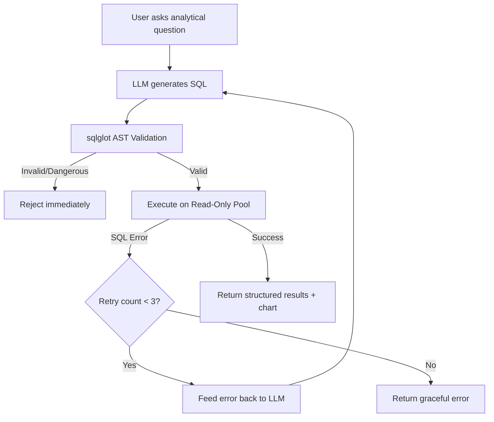
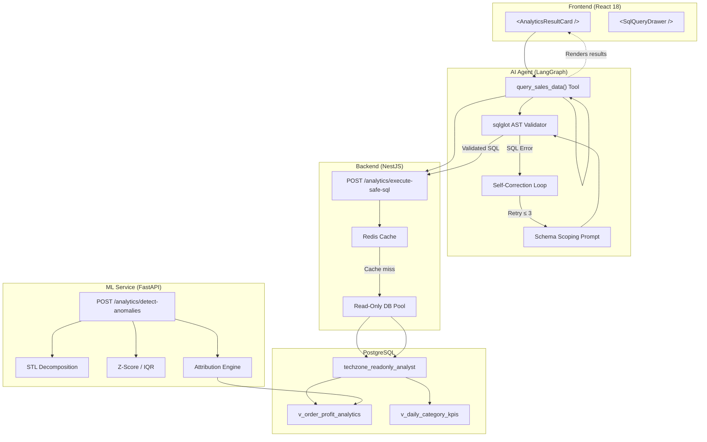

# 🧑‍💻 Abdallah — Implementation Plan

**Role:** Conversational BI Analytics & Secure Text-to-SQL Engine  
**Vertical Slice:** BI Analytics & Secure Text-to-SQL  
**PDF Sections:** 3.2, 4.4, 5.1 & 7.4  

> **Mission:** Own the conversational Business Intelligence & Text-to-SQL pipeline where merchants ask natural language analytical questions (e.g., _"What are the top 5 products that generated the highest net profit last week in Cairo?"_) and receive validated SQL results as interactive charts and tables.

---

## 📋 Task Overview

| # | Layer | Task Title | Status |
|---|-------|-----------|--------|
| 1 | 🖥️ Frontend & GenUI | Adaptive BI Chart Visualizer & SQL Inspector UI | ✅ Completed |
| 2 | ⚙️ Backend & API | Sandboxed SQL Execution Runner, Timeouts & Redis Cache | ✅ Completed |
| 3 | 🗄️ Database & Analytical | Read-Only DB Role, Analytical Views & Olist Seeding | ✅ Completed |
| 4 | 🤖 AI Agent & LLM | `query_sales_data` Tool + `sqlglot` AST Guard & Self-Correction | ✅ Completed |
| 5 | 📊 ML & Data Science | Revenue & Net Profit Anomaly Detection & Root-Cause Explainer | ✅ Completed |

---

## Task 1 — Frontend & Generative UI (React 18 + Vite + Recharts + TanStack Table)

### 📌 Adaptive BI Chart Visualizer (`<AnalyticsResultCard />`) & SQL Inspector UI

**Summary:** Build the React Generative UI component that automatically turns structured SQL results into interactive charts, KPI cards, and sortable tables.

### Implementation Steps

#### Step 1.1 — Build `<AnalyticsResultCard />`
- Use **Recharts** (`ResponsiveContainer`, `BarChart`, `LineChart`, `AreaChart`, `PieChart`) and **TanStack Table**
- **Auto-detect chart type** based on returned column types:
  - `Date + Metric` → Line Chart
  - `Category/City + Metric` → Bar Chart
  - Single value → KPI card
- The component receives structured data from the agent tool response and renders accordingly

#### Step 1.2 — Interactive Controls Inside Chat Card
- Add toggle to switch between **Chart View** and **Table View**
- **Export** query results to CSV/Excel (client-side download)
- Collapsible **"Verified SQL Query"** badge showing:
  - The validated SQL that was executed
  - Execution time (ms)
  - Row count returned

#### Step 1.3 — RTL & Currency Support
- Support **RTL Arabic axis labels** on all Recharts components
- Format EGP currency tooltips properly (e.g., `14,500 ج.م`)
- Ensure all chart labels, legends, and tooltips respect `i18next` locale

### 📁 Files to Create/Modify
```
apps/web/src/components/gen-ui/AnalyticsResultCard.tsx
apps/web/src/components/gen-ui/SqlQueryDrawer.tsx
```

### 📦 Dependencies
```
react@18, recharts, @tanstack/react-table, lucide-react
```

### ✅ Deliverable
> Generative React BI component rendering publication-quality charts and sortable tables directly inside the conversation.

### 🧪 Acceptance Criteria
- [ ] Component renders correct chart type automatically based on data shape
- [ ] Toggle between Chart View and Table View works
- [ ] CSV/Excel export produces valid downloadable file
- [ ] SQL badge shows query text, execution time, and row count
- [ ] Arabic RTL labels render correctly on all chart types
- [ ] EGP currency formatting works in tooltips

---

## Task 2 — Backend & API Layer (NestJS / FastAPI + PostgreSQL Read Pool + Redis)

### 📌 Sandboxed SQL Execution Runner, Statement Timeouts, Row Limits & Query Caching

**Summary:** Build the isolated backend query runner that executes validated analytical queries against a Read-Only connection pool with strict resource limits.

### Implementation Steps

#### Step 2.1 — Dedicated Read-Only Connection Pool
- Create a **separate PostgreSQL connection pool** configured exclusively with the `techzone_readonly_analyst` database role
- This role has **zero write permissions** at the database engine level
- Pool configuration: max connections, idle timeout, connection validation

#### Step 2.2 — Hard Execution Guardrails
- Every query execution must be wrapped with:
  ```sql
  SET LOCAL statement_timeout = '3000ms';
  ```
- Enforce **`LIMIT 500`** maximum rows on every query result
- **Block multi-statement queries** (detect and reject `;` separating multiple statements)
- Return clear error messages when guardrails trigger

#### Step 2.3 — Redis Query Caching
- Cache normalized SQL AST hashes in Redis:
  - Key pattern: `bi:query:{tenant_id}:{sql_hash}`
  - TTL: **5 minutes**
- For dashboard and repeat-question responses, return cached results instantly
- Cache invalidation strategy for stale data

### 📁 Files to Create/Modify
```
apps/api/src/analytics/analytics.controller.ts
apps/api/src/analytics/analytics.service.ts
apps/api/src/analytics/readonly-pool.provider.ts
```

### 🔌 Endpoint
```
POST /api/v1/analytics/execute-safe-sql
```

**Request Body:**
```json
{
  "sql": "SELECT ... FROM v_order_profit_analytics WHERE tenant_id = :tid ...",
  "params": {},
  "preferred_chart": "bar"
}
```

**Response:**
```json
{
  "columns": ["product_name", "net_profit"],
  "rows": [...],
  "row_count": 42,
  "execution_time_ms": 187,
  "cached": false,
  "chart_hint": "bar"
}
```

### 🔒 Security
- Dedicated Read-Only DB Pool
- 3-second statement timeout
- 500-row cap per query
- Multi-statement blocking

### ✅ Deliverable
> Bulletproof sandboxed SQL execution service immune to resource exhaustion and unauthorized writes.

### 🧪 Acceptance Criteria
- [ ] Queries execute against read-only pool (no writes possible at DB level)
- [ ] Queries exceeding 3 seconds are terminated with clear error
- [ ] Results are capped at 500 rows maximum
- [ ] Multi-statement queries (containing `;`) are rejected
- [ ] Cached queries return instantly from Redis within TTL
- [ ] Endpoint returns structured columns, rows, timing, and chart hint

---

## Task 3 — Database & Analytical Layer (PostgreSQL Read-Only Role + Views + Dataset Seeding)

### 📌 Read-Only DB Role, Semantic Analytical Views (`v_sales_net_profit`) & Olist Seeding

**Summary:** Create simplified analytical SQL views that make LLM Text-to-SQL generation highly accurate, and seed realistic multi-city Egyptian e-commerce data.

### Implementation Steps

#### Step 3.1 — Create the Read-Only PostgreSQL Role
```sql
CREATE ROLE techzone_readonly_analyst NOLOGIN;
GRANT CONNECT ON DATABASE techzone TO techzone_readonly_analyst;
GRANT USAGE ON SCHEMA public TO techzone_readonly_analyst;
GRANT SELECT ON ALL TABLES IN SCHEMA public TO techzone_readonly_analyst;
ALTER DEFAULT PRIVILEGES IN SCHEMA public
  GRANT SELECT ON TABLES TO techzone_readonly_analyst;
```

#### Step 3.2 — Build Denormalized Analytical Views
Create views **specifically designed for LLM comprehension** (simple column names, pre-joined data):

**`v_order_profit_analytics`** — Pre-calculates:
- `gross_revenue`
- `total_cost`
- `net_profit = ((oi.unit_price * (1 - oi.discount)) - p.cost) * oi.quantity`
- Joined with: product name, category, customer city, order timestamp

**`v_daily_category_kpis`** — Daily aggregated KPIs by category

> [!IMPORTANT]
> These views are the **primary target** for the LLM's Text-to-SQL generation. Column names must be descriptive and unambiguous to maximize SQL generation accuracy.

#### Step 3.3 — Master ETL Seeding Script
- Import **Olist Brazilian E-Commerce** dataset
- Import **AdventureWorks** dataset
- Map to Egyptian cities: `Cairo`, `Alexandria`, `Giza`, `Mansoura`, `Tanta`
- Map to realistic electronics products (speakers, headphones, mobile accessories, etc.)
- Target: **50,000+ realistic seeded order rows**

### 📁 Files to Create/Modify
```
packages/database/sql/analytical_views.sql
packages/database/sql/create_readonly_role.sql
packages/database/seed/seed_olist_egypt.py
```

### ✅ Deliverable
> Pre-joined analytical SQL views and 50,000+ realistic seeded order rows for rich analytical demos.

### 🧪 Acceptance Criteria
- [ ] `techzone_readonly_analyst` role has SELECT-only access (no INSERT/UPDATE/DELETE)
- [ ] `v_order_profit_analytics` view returns correct net profit calculations
- [ ] `v_daily_category_kpis` returns daily aggregated metrics
- [ ] Seeding script imports 50,000+ order rows successfully
- [ ] Data is mapped to Egyptian cities and EGP currency
- [ ] Views include `tenant_id` filtering for RLS compatibility

---

## Task 4 — AI Agent & LLM Layer (LangGraph + `sqlglot` AST Guard + Self-Correction Loop)

### 📌 `query_sales_data(natural_language)` Tool, `sqlglot` AST Validator & 3-Retry Self-Correction

**Summary:** Build the 5-layer secured Text-to-SQL pipeline (Section 7.4) with AST parsing, automatic `tenant_id` injection, and self-correcting error recovery.

### Implementation Steps

#### Step 4.1 — Schema Scoping Prompt
- Provide the LLM **only** with permitted analytical tables/views
- Include column descriptions and data types
- Include **few-shot examples** in both Arabic and English:
  ```
  User: "ايه أكتر 5 منتجات حققت ربح الأسبوع اللي فات في القاهرة؟"
  SQL: SELECT product_name, SUM(net_profit) as total_profit
       FROM v_order_profit_analytics
       WHERE city = 'Cairo' AND order_date >= CURRENT_DATE - INTERVAL '7 days'
       GROUP BY product_name
       ORDER BY total_profit DESC LIMIT 5;
  ```

#### Step 4.2 — `sqlglot` AST Security Validator
The 5-layer security pipeline:

1. **Parse** LLM-generated SQL into an Abstract Syntax Tree using `sqlglot`
2. **Reject** any AST containing dangerous nodes:
   - `DROP`, `DELETE`, `UPDATE`, `INSERT`, `ALTER`, `GRANT`, `COPY`
   - System catalog access (`pg_catalog`, `information_schema`)
   - Subqueries to non-whitelisted tables
3. **Verify/Inject** `WHERE tenant_id = :current_tenant_id` — ensure tenant isolation even if the LLM forgets
4. **Enforce** `LIMIT` clause (max 500)
5. **Validate** all referenced tables/columns exist in the permitted schema

```python
# Pseudocode for AST validation
import sqlglot

def validate_sql(sql: str, tenant_id: str) -> str:
    parsed = sqlglot.parse_one(sql, dialect="postgres")
    
    # Check for forbidden operations
    for node in parsed.walk():
        if isinstance(node, (Drop, Delete, Update, Insert, Alter, Grant)):
            raise SecurityError(f"Forbidden operation: {type(node).__name__}")
    
    # Inject tenant_id filter
    parsed = inject_tenant_filter(parsed, tenant_id)
    
    # Enforce LIMIT
    parsed = enforce_limit(parsed, max_rows=500)
    
    return parsed.sql(dialect="postgres")
```

#### Step 4.3 — Self-Correction Graph Loop
- If PostgreSQL returns a **syntax or column error** (e.g., wrong GROUP BY, bad date cast):
  1. Capture the exact database error message
  2. Feed it back to the LLM with context: _"Your SQL failed with this error: ... Please fix and rewrite."_
  3. Re-validate the corrected SQL through the AST validator
  4. **Maximum 3 automatic retries** before returning a graceful error to the user



### 📁 Files to Create/Modify
```
apps/agent/tools/analytics_tools.py
apps/agent/tools/sql_validator.py
apps/agent/graphs/text_to_sql_graph.py
apps/agent/prompts/schema_scoping_prompt.txt
```

### 🔧 Tool Definition
```python
@tool
def query_sales_data(
    question: str,           # Natural language question (Arabic or English)
    preferred_chart: str = "auto"  # "bar", "line", "pie", "table", or "auto"
) -> dict:
    """
    Converts a natural language business question into validated SQL,
    executes it safely, and returns structured results with chart hints.
    Read-Only operation — no confirmation required.
    """
```

### 📦 Dependencies
```
sqlglot, langgraph, langchain-core
```

### ✅ Deliverable
> 5-layer secured Text-to-SQL agent achieving >92% execution accuracy on complex multi-join analytical questions.

### 🧪 Acceptance Criteria
- [ ] LLM generates valid SQL from Arabic and English questions
- [ ] `sqlglot` AST validator blocks all write operations (DROP, DELETE, UPDATE, INSERT, etc.)
- [ ] `tenant_id` is programmatically injected/verified in every query
- [ ] System catalog access (`pg_catalog`) is blocked
- [ ] Self-correction loop fixes simple SQL errors within 3 retries
- [ ] Few-shot examples improve accuracy for Egyptian e-commerce domain
- [ ] Tool returns structured data with chart type hints

---

## Task 5 — Machine Learning & Data Science Layer (Python FastAPI + Statsmodels + Pandas)

### 📌 Automated Revenue & Net Profit Anomaly Detection & Root-Cause Explainer

**Summary:** Complement descriptive SQL queries with an automated statistical anomaly detector that spots unusual profit drops or city-level spikes and explains why.

### Implementation Steps

#### Step 5.1 — Build the Anomaly Detection Endpoint
- Create `POST /ml/v1/analytics/detect-anomalies` in FastAPI
- Implement using **`statsmodels` Seasonal Decomposition (STL)**:
  - Decompose daily revenue/profit into trend, seasonal, and residual components
- Apply **Rolling Z-Score** and **Interquartile Range (IQR)** methods:
  - Flag data points where `|Z| > 2.5` as anomalies
  - IQR method: flag values outside `[Q1 - 1.5×IQR, Q3 + 1.5×IQR]`
- Monitor three key metrics:
  - Daily revenue
  - Daily net profit
  - Daily cancellation rate

#### Step 5.2 — Automated Drill-Down Attribution
When a significant anomaly is detected:
- Automatically **drill down** across multiple dimensions:
  - **Categories**: Which product categories caused the spike/drop?
  - **Cities**: Which cities are responsible?
  - **Stockouts**: Did any stockout events correlate with the anomaly?
- Identify the **primary driver** using contribution analysis
- Example output: _"Cairo speaker sales dropped 35% — primary driver: stockout of SKU-1234 (your #2 best seller) since Oct 15"_

#### Step 5.3 — Proactive Agent Integration
- Return structured anomaly insights to the Agent
- When a merchant asks _"How is my store performing this week?"_, the Agent should **proactively highlight**:
  - Statistically significant revenue trends (up or down)
  - Root causes with actionable recommendations
  - Comparison to the same period last week/month

**Response Schema:**
```json
{
  "anomalies": [
    {
      "metric": "net_profit",
      "date": "2026-10-18",
      "value": 12500,
      "expected_value": 18900,
      "z_score": -3.1,
      "severity": "high",
      "direction": "drop",
      "root_causes": [
        {
          "dimension": "category",
          "value": "speakers",
          "contribution_pct": 62,
          "explanation": "Speaker sales in Cairo dropped 35% due to stockout of SKU-1234"
        }
      ]
    }
  ],
  "summary": "Revenue anomaly detected: 34% drop in net profit driven by speaker stockouts in Cairo."
}
```

### 📁 Files to Create/Modify
```
apps/ml-service/app/routers/anomaly_detection.py
apps/ml-service/app/services/anomaly_service.py
apps/ml-service/app/services/attribution_service.py
```

### 🔌 Endpoint
```
POST /ml/v1/analytics/detect-anomalies
```

### 📦 Dependencies
```
statsmodels, pandas, numpy, scipy, fastapi
```

### ✅ Deliverable
> Statistical anomaly detection service that automatically surfaces revenue spikes/drops and their root causes.

### 🧪 Acceptance Criteria
- [ ] STL decomposition correctly separates trend/seasonal/residual components
- [ ] Z-Score method flags anomalies where `|Z| > 2.5`
- [ ] IQR method provides complementary anomaly detection
- [ ] Drill-down attribution identifies category, city, and stockout drivers
- [ ] Response includes severity, direction, and root cause explanations
- [ ] Agent can proactively surface anomalies in natural language responses

---

## 🗓️ Execution Timeline (12-Week Roadmap)

| Phase | Weeks | Abdallah's Focus |
|-------|-------|-----------------|
| **Phase 1 — Foundation** | 1–2 | Database schema, read-only role, analytical views, Olist data seeding (Task 3) |
| **Phase 2 — Core Read Agent** | 3–4 | `query_sales_data` tool, `sqlglot` AST validator, self-correction loop (Task 4) |
| **Phase 3 — Machine Learning** | 5–6 | Revenue anomaly detection, STL decomposition, root-cause explainer (Task 5) |
| **Phase 4 — Write Tools & HITL** | 7–8 | Sandboxed SQL runner backend, Redis caching, guardrails (Task 2) |
| **Phase 5 — Generative UI** | 9–10 | `<AnalyticsResultCard />`, Recharts integration, RTL/EGP support (Task 1) |
| **Phase 6 — Evaluation & Defense** | 11–12 | Text-to-SQL execution accuracy benchmarks, demo preparation |

---

## 🔗 Dependencies on Other Team Members

| Dependency | Owner | What Abdallah Needs |
|-----------|-------|-------------------|
| Multi-tenant RLS & `tenant_id` context | **Moustafa** | RLS policies active on all tables; `tenant_id` available in request context |
| `products`, `inventory`, `categories` tables | **Adel** | Product catalog schema and seeded data for analytical views |
| `customers`, `orders`, `order_items` tables | **Renad** | Order transaction data for revenue/profit calculations |
| Command Center Chat UI & GenUI Registry | **Roaa** | `<AnalyticsResultCard />` registered in the GenUI component registry |
| Forecast data for anomaly correlation | **Retaj** | Time-series data and forecast predictions for cross-referencing anomalies |

---

## 📐 Architecture Diagram



---

> [!TIP]
> **Recommended Implementation Order:** Start with Task 3 (Database) → Task 4 (AI/SQL) → Task 2 (Backend) → Task 5 (ML) → Task 1 (Frontend). This builds from data layer up, ensuring each layer has its dependencies ready.
