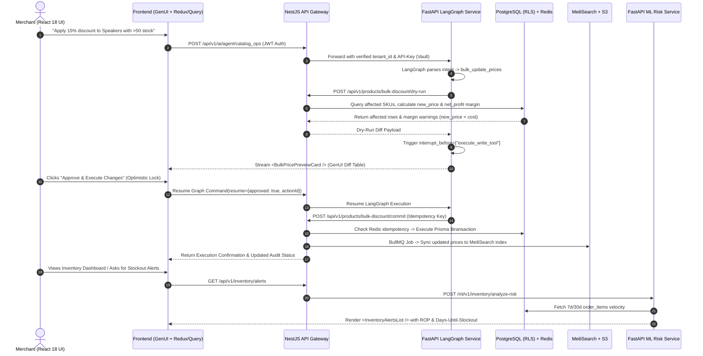
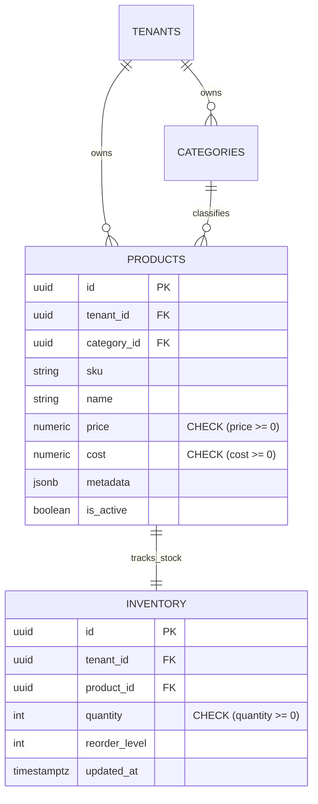

# Project-AI (TechZone) — Vertical Slice 02: Autonomous Catalog, Inventory & HITL Operations

**Slice Owner:** Adel (عادل)  
**Role:** Autonomous Catalog, Inventory & Human-in-the-Loop (HITL) Operations Lead  
**Arabic Title:** الإدارة الذاتية للمنتجات والمخزون ونظام المعاينة والتأكيد (HITL)  
**System Design Alignment:** Sections 3.2, 4.3, 5.1–5.6, 6, 7.2, 7.7, 8–12  
**Date:** 2026-10-21  

---

## 1. Executive Summary & Vertical Slice Scope

Within **Project-AI (TechZone)**, Adel owns the end-to-end **Catalog, Inventory & Human-in-the-Loop (HITL) Operations** vertical slice across all five engineering layers. This slice enables merchants to manage products and inventory autonomously via natural language (e.g., *"Add a $15\%$ discount to all products in the speakers category with $> 50$ units in stock"*) while enforcing strict **Human-in-the-Loop (HITL)** visual confirmation, atomic database transactions, margin safety guardrails, and probabilistic stockout predictions.

### Core Architectural Guarantees (Per System Design)
| Pillar | System Design Standard Applied to Adel's Slice |
| :--- | :--- |
| **Multi-Tenant Isolation** | PostgreSQL Row-Level Security (RLS) via `app.tenant_id` / `app.current_tenant_id` session variables and per-tenant schema scoping (`tenant_{id}`). |
| **Latency & Throughput Budgets** | $< 200\text{ ms}$ average latency for Catalog/Inventory REST API calls; $< 500\text{ ms}$ for AI Agent dry-run preview generation; scaled for $10\text{ k}$ RPS peak. |
| **Caching & Idempotency** | Redis caching ($\text{TTL} = 60\text{ s}$) for read-heavy catalog endpoints (`GET /api/v1/products`) and Redis idempotency locks (`idempotency:action:{action_id}`) for bulk write mutations. |
| **Search Synchronization** | Sub-$50\text{ ms}$ bilingual (Arabic/English) typo-tolerant search via MeiliSearch synced with PostgreSQL via Change-Data-Capture (CDC) / BullMQ domain events. |
| **Observability & Compliance** | Prometheus `/metrics` scraping, OpenTelemetry spans, ELK structured JSON logs, and Langfuse traces (`trace_id`, `step_name`, `duration`) for every tool call and HITL interrupt. |
| **Testing Coverage** | $\ge 90\%$ unit/integration test coverage across Jest, React Testing Library, Supertest, pytest, and Cypress E2E flows. |

---

## 2. Slice Architecture & HITL Execution Flow



---

## 3. Detailed 5-Layer Task Breakdown

### Task 1 (`ADEL-FE`): Frontend & Generative UI Layer
**Layer Stack:** React 18, Vite, Tailwind CSS (JIT), `shadcn/ui`, TanStack Query, Redux Toolkit, `react-i18next` (RTL)  
**Task Title:** Human-in-the-Loop Diff Preview Cards (`<BulkPricePreviewCard />`) & Inventory Alerts UI  

#### 1.1 Implementation Steps
1. **Lazy-Loaded Vertical Slice Module & State Management:**
   * Register lazy-loaded routes under React Router v6 (`src/main.tsx`) for `/dashboard/products` and `/dashboard/inventory`.
   * Use Context API for tenant/auth context and **Redux Toolkit** for complex interactive product/inventory data grids (inline filtering, multi-SKU selection, sorting, and pagination).
   * Use **TanStack Query** for server-state synchronization, optimistic updates, and cache invalidation upon HITL approval.
2. **Generative UI Diff Preview Cards (`<BulkPricePreviewCard />` & `<ProductUpdatePreviewCard />`):**
   * Render a structured diff table inside the chat stream whenever the Agent proposes modifying product prices, metadata, or inventory levels.
   * Display columns: `SKU`, `Product Name`, `Current Price`, `Proposed Discounted Price`, `Unit Cost`, `New Net Profit Margin (%)`, and `Total Affected SKUs`.
   * Highlight rows in amber/red if the proposed discount triggers a margin floor warning ($\text{new\_price} < \text{cost}$).
   * Wire the **"Approve & Execute Changes"** and **"Cancel / Modify"** buttons to dispatch the LangGraph resume payload `Command(resume={ approved: true, actionId })`.
   * Enforce an **Optimistic UI Lock**: disable the confirmation button immediately upon click to prevent duplicate submissions.
3. **Inventory Alerts Widget & Media Dropzone (`<InventoryAlertsList />`):**
   * Build the Generative UI `<InventoryAlertsList />` card and the full Merchant Products Dashboard page.
   * Include instant MeiliSearch-backed search bar, stock-status badges (`In Stock`, `Low Stock`, `Critical Stockout Risk`), and a drag-and-drop image uploader utilizing pre-signed S3/Cloudinary URLs.
4. **Internationalization (i18n) & RTL Support:**
   * Add complete Arabic (`public/locales/ar/catalog.json`) and English (`public/locales/en/catalog.json`) translation keys with full RTL layout compatibility.

#### 1.2 Key Files & Deliverables
* **Files:**
  * `apps/web/src/components/gen-ui/BulkPricePreviewCard.tsx`
  * `apps/web/src/components/gen-ui/ProductUpdatePreviewCard.tsx`
  * `apps/web/src/components/gen-ui/InventoryAlertsList.tsx`
  * `apps/web/src/pages/dashboard/ProductsGridPage.tsx`
  * `apps/web/src/store/catalogSlice.ts`
* **Deliverable & Acceptance Criteria:** Interactive React Generative UI diff cards and Redux Toolkit product grids with $\ge 90\%$ unit test coverage (Jest + React Testing Library) and E2E Cypress verification.

---

### Task 2 (`ADEL-BE`): Backend & API Gateway Layer
**Layer Stack:** NestJS (Modular Monorepo), Prisma Transactions, Redis, BullMQ, Clerk/JWT Guard, S3 / Cloudinary  
**Task Title:** Transactional Catalog CRUD, Dry-Run Preview Engine, Idempotency & Media Upload  

#### 2.1 Implementation Steps
1. **Modular NestJS Controllers & Guards:**
   * Implement `ProductsController`, `ProductsService`, `InventoryController`, and `InventoryService` inside the NestJS monorepo (`apps/api/src/products`, `apps/api/src/inventory`).
   * Protect all endpoints with `@UseGuards(JwtAuthGuard)` to extract `tenant_id` from the verified Clerk RSA-2048 JWT token (never from client payload bodies).
   * Validate all incoming payloads using `class-validator` DTOs and document all routes with Swagger decorators (`@ApiTags('Catalog & Inventory')`, `@ApiOperation`, `@ApiResponse`).
2. **Two-Phase Bulk Execution Pattern (Dry-Run vs. Commit):**
   * `POST /api/v1/products/bulk-discount/dry-run`: Queries candidate products matching filter criteria, computes before/after prices, evaluates net profit impact, and returns a preview payload **without** committing changes to PostgreSQL.
   * `POST /api/v1/products/bulk-discount/commit`: Executes the approved bulk price update across $1,000+$ SKUs inside a single atomic Prisma `$transaction`.
3. **Redis Caching & Idempotency Enforcement:**
   * Cache read-heavy catalog search and product detail endpoints in Redis with $\text{TTL} = 60\text{ s}$ (`catalog:products:{tenant_id}:{query_hash}`), and pre-warm hot product data upon tenant activation.
   * Enforce strict write **Idempotency** in Redis (`idempotency:action:{action_id}`, $\text{TTL} = 24\text{ h}$): if the Agent or client retries an approved commit request, return the cached execution result without applying the discount a second time.
4. **Media Uploads & BullMQ Search Sync Workers:**
   * Generate pre-signed AWS S3 / Cloudinary upload URLs (`POST /api/v1/products/media/presign`) for secure direct browser uploads.
   * Dispatch asynchronous **BullMQ** jobs (`catalog.sync.meilisearch`) whenever products or inventory levels change so MeiliSearch stays in sync without increasing API response latency.

#### 2.2 Key Files & Deliverables
* **Endpoints:**
  * `GET /api/v1/products` (Redis cached, MeiliSearch filtered)
  * `PATCH /api/v1/products/:id`
  * `POST /api/v1/products/bulk-discount/dry-run`
  * `POST /api/v1/products/bulk-discount/commit`
  * `GET /api/v1/inventory/alerts`
  * `POST /api/v1/products/media/presign`
* **Files:**
  * `apps/api/src/products/products.controller.ts`
  * `apps/api/src/products/products.service.ts`
  * `apps/api/src/inventory/inventory.service.ts`
  * `apps/api/src/jobs/meilisearch-sync.processor.ts`
* **Deliverable & Acceptance Criteria:** Atomic, idempotent NestJS catalog service maintaining $< 200\text{ ms}$ API response latency and updating $1,000+$ SKUs safely within a single Prisma transaction.

---

### Task 3 (`ADEL-DB`): Database, Security & Search Layer
**Layer Stack:** PostgreSQL 15/16, Prisma ORM, SQLAlchemy, Row-Level Security (RLS), MeiliSearch  
**Task Title:** `categories`, `products`, `inventory` Schema, Profit Constraints & Arabic Search Index  

#### 3.1 Implementation Steps
1. **Relational Schema & Profit Margin Separation:**
   * Define Prisma models (`packages/database/prisma/schema.prisma`) and corresponding SQLAlchemy models (for FastAPI) for:
     * `categories (id UUID PK, tenant_id UUID FK, name TEXT, parent_id UUID FK)`
     * `products (id UUID PK, tenant_id UUID FK, category_id UUID FK, sku VARCHAR, name TEXT, price NUMERIC(12,2), cost NUMERIC(12,2), metadata JSONB, is_active BOOLEAN)`
     * `inventory (id UUID PK, tenant_id UUID FK, product_id UUID FK UNIQUE, quantity INT, reorder_level INT, updated_at TIMESTAMPTZ)`
   * Explicitly separate `cost` from `price` to enable exact Net Profit calculation and negative-margin protection.
2. **Database Integrity Constraints, Indexes & RLS Isolation:**
   * Add PostgreSQL `CHECK` constraints: `CHECK (price >= 0)`, `CHECK (cost >= 0)`, and `CHECK (quantity >= 0)`.
   * Create composite B-Tree indexes on `(tenant_id, category_id, is_active)` and `(tenant_id, sku)` for sub-$10\text{ ms}$ filtering.
   * Apply PostgreSQL **Row-Level Security (RLS)** policies enforcing `tenant_id = current_setting('app.tenant_id')::uuid` across `categories`, `products`, and `inventory` within the multi-tenant model.
3. **MeiliSearch Bilingual Index Configuration:**
   * Configure the `products_index` in MeiliSearch with Arabic stop-words, typo tolerance, prefix search, and bilingual synonyms (e.g., `سماعات` $\leftrightarrow$ `speakers` $\leftrightarrow$ `headphones`, `شاحن` $\leftrightarrow$ `charger`).
   * Configure `filterableAttributes`: `['tenant_id', 'category_id', 'price', 'quantity', 'is_active']` and `sortableAttributes`: `['price', 'quantity', 'updated_at']`.

#### 3.2 Database ER Sub-Model (Adel's Tables)


#### 3.3 Key Files & Deliverables
* **Files:**
  * `packages/database/prisma/schema.prisma`
  * `packages/database/sql/catalog_rls_and_constraints.sql`
  * `packages/search/meilisearch_config.json`
* **Deliverable & Acceptance Criteria:** Indexed, RLS-protected PostgreSQL catalog schema synced with MeiliSearch supporting $< 50\text{ ms}$ bilingual Arabic/English search queries.

---

### Task 4 (`ADEL-AI`): AI Agent & LLM Orchestration Layer
**Layer Stack:** FastAPI (`fastapi[async]`), LangGraph, Claude 3.5 Sonnet (GPT-4o Fallback), Vault API-Key Guard, Langfuse  
**Task Title:** `search_products`, `update_product`, `bulk_update_prices` & LangGraph HITL Workflow  

#### 4.1 Implementation Steps
1. **FastAPI Agent Endpoint & Security Dependencies:**
   * Expose Adel's catalog sub-graph via FastAPI (`/agents/catalog_ops`) using `Depends(get_tenant)` to enforce tenant isolation and validating the `X-API-Key` header against HashiCorp Vault secrets.
2. **Structured Agent Tool Definitions:**
   * Implement strict Pydantic input/output schemas for four core tools:
     * `search_products(query: str, category: Optional[str], min_stock: Optional[int], max_price: Optional[float])` — *Read Operation (No confirmation required)*.
     * `get_inventory_alerts(urgency_filter: Optional[str])` — *Read/ML Operation (No confirmation required)*.
     * `update_product(product_id: UUID, fields: ProductUpdatePatch)` — *Write Operation (Requires HITL confirmation)*.
     * `bulk_update_prices(filter_criteria: CatalogFilter, discount_pct: float)` — *Write Operation (Requires HITL confirmation)*.
3. **LangGraph Checkpointer & HITL Interrupt Gate:**
   * Configure LangGraph with `PostgresSaver` / `MemorySaver` checkpointer and `interrupt_before=["execute_write_tool"]`.
   * When Claude 3.5 Sonnet (or GPT-4o fallback) selects `bulk_update_prices` or `update_product`, the `hitl_gate_node` invokes the NestJS `dry-run` endpoint, attaches the diff payload to the graph state, emits a **Langfuse** trace span (`trace_id`, `step_name="hitl_dry_run"`, `duration`), and suspends graph execution until the merchant approves.
4. **Margin Safety Guardrail:**
   * Programmatically inspect the dry-run output inside the Agent node: if any SKU's proposed price falls below unit cost ($\text{new\_price} < \text{cost}$), inject a prominent warning into the Agent response and require explicit merchant override.

#### 4.2 Key Files & Deliverables
* **Files:**
  * `apps/agent/tools/catalog_tools.py`
  * `apps/agent/nodes/hitl_gate_node.py`
  * `apps/agent/graphs/catalog_agent_graph.py`
* **Deliverable & Acceptance Criteria:** LangGraph HITL pipeline that completes dry-run previews in $< 500\text{ ms}$, pauses before any database write, warns on negative profit margins, and logs $100\%$ of traces to Langfuse.

---

### Task 5 (`ADEL-ML`): Machine Learning & Data Science Layer
**Layer Stack:** Python FastAPI, NumPy, SciPy (`scipy.stats`), Pandas, MLflow Registry, Prometheus Metrics  
**Task Title:** Dynamic Safety Stock Optimization & Probabilistic Days-Until-Stockout Predictor  

#### 5.1 Mathematical Formulation & Implementation Steps
1. **Rolling Demand Velocity & Volatility Extraction:**
   * Build `POST /ml/v1/inventory/analyze-risk` in FastAPI (`apps/ml-service/app/routers/inventory_risk.py`).
   * Query historical `order_items` for the active tenant to compute each SKU's rolling $7\text{-day}$ and $30\text{-day}$ daily demand mean ($\mu_d$), exponentially weighted moving average velocity ($\text{EWMA}_d$), and daily demand standard deviation ($\sigma_d$).
2. **Probabilistic Safety Stock & Dynamic Reorder Point ($\text{ROP}$):**
   * Given supplier lead time $L$ (in days) and a target service level of $95\%$ ($Z_{0.95} = 1.645$), compute **Safety Stock ($\text{SS}$)** and **Reorder Point ($\text{ROP}$)**:
     $$\text{SS} = Z_{0.95} \cdot \sigma_d \sqrt{L}$$
     $$\text{ROP} = (\mu_d \times L) + \text{SS} = (\mu_d \times L) + 1.645 \cdot \sigma_d \sqrt{L}$$
3. **Days-Until-Stockout & Lost Profit Prioritization:**
   * Estimate expected **Days Until Stockout ($\text{DUS}$)** for each SKU with current stock $Q_{\text{current}}$:
     $$\text{DUS} = \frac{Q_{\text{current}}}{\max(\text{EWMA}_d, \epsilon)}$$
   * Calculate **Projected Daily Lost Net Profit** if a stockout occurs:
     $$\text{Daily Profit at Risk} = \text{EWMA}_d \times (\text{price} - \text{cost})$$
   * Rank SKUs where $Q_{\text{current}} \le \text{ROP}$ by $\text{Daily Profit at Risk}$ in descending order so `get_inventory_alerts()` highlights the highest-margin urgent items first.
4. **MLflow Tracking & Prometheus Telemetry:**
   * Log safety stock parameters and backtest stockout accuracy metrics in **MLflow** (`mlflow:2.10`) and expose `/metrics` for Prometheus scraping.

#### 5.2 Key Files & Deliverables
* **Endpoint:** `POST /ml/v1/inventory/analyze-risk`
* **Files:**
  * `apps/ml-service/app/routers/inventory_risk.py`
  * `apps/ml-service/app/models/stockout_optimizer.py`
* **Deliverable & Acceptance Criteria:** Probabilistic inventory risk microservice predicting exact stockout dates and dynamically recommending optimal `reorder_level` thresholds per SKU.

---

## 4. API Specification & Payload Contracts (Adel's Slice)

| Method | Path | Auth | Caching / Guard | Description |
| :--- | :--- | :--- | :--- | :--- |
| `GET` | `/api/v1/products` | JWT (Tenant) | Redis ($\text{TTL} = 60\text{ s}$) | Search & filter products via MeiliSearch/PostgreSQL. |
| `PATCH` | `/api/v1/products/:id` | JWT (Tenant) | Idempotency Key | Update single product attributes or price. |
| `POST` | `/api/v1/products/bulk-discount/dry-run` | JWT / Vault Key | Read-Only Transaction | Calculate affected SKUs, new prices, and margin warnings without DB write. |
| `POST` | `/api/v1/products/bulk-discount/commit` | JWT (Tenant) | Redis Idempotency Lock | Commit approved HITL bulk price update in a single Prisma `$transaction`. |
| `GET` | `/api/v1/inventory/alerts` | JWT (Tenant) | Redis ($\text{TTL} = 60\text{ s}$) | Retrieve prioritized stockout alerts and dynamic $\text{ROP}$ recommendations. |
| `POST` | `/ml/v1/inventory/analyze-risk` | Vault API-Key | FastAPI Async Worker | Compute $\mu_d$, $\sigma_d$, $\text{ROP}$, $\text{DUS}$, and daily profit at risk. |

### Sample Dry-Run Response Payload (`POST /api/v1/products/bulk-discount/dry-run`)
```json
{
  "actionId": "act_9f8e7d6c-5b4a-4321-8765-123456789abc",
  "status": "PENDING_CONFIRMATION",
  "filterCriteria": {
    "category": "Speakers",
    "minStock": 50,
    "discountPct": 15.0
  },
  "summary": {
    "totalAffectedSkus": 14,
    "averageMarginBeforePct": 32.5,
    "averageMarginAfterPct": 20.6,
    "negativeMarginCount": 1
  },
  "previewRows": [
    {
      "productId": "prod_101",
      "sku": "SPK-JBL-01",
      "name": "JBL Flip 6 Waterproof Speaker",
      "quantity": 72,
      "cost": 3800.00,
      "currentPrice": 5000.00,
      "proposedPrice": 4250.00,
      "newNetProfitPerUnit": 450.00,
      "newMarginPct": 10.59,
      "marginWarning": false
    },
    {
      "productId": "prod_109",
      "sku": "SPK-MINI-09",
      "name": "Mini Bluetooth Pocket Speaker",
      "quantity": 64,
      "cost": 450.00,
      "currentPrice": 500.00,
      "proposedPrice": 425.00,
      "newNetProfitPerUnit": -25.00,
      "newMarginPct": -5.88,
      "marginWarning": true
    }
  ]
}
```

---

## 5. Testing, Observability & Deployment Checklist (System Design Sections 8–12)

| Category | Tool / Framework | Adel's Specific Verification Scope | Target |
| :--- | :--- | :--- | :--- |
| **Unit Tests (FE & BE)** | Jest, React Testing Library, `pytest` | Test `<BulkPricePreviewCard />` button locking, Redux grid reducers, NestJS price calculation, and SciPy $\text{ROP}$ math. | $\ge 90\%$ Coverage |
| **Integration Tests** | Supertest (NestJS), FastAPI `TestClient` | Verify `dry-run` leaves DB unchanged, `commit` updates all rows atomically, and duplicate `actionId` calls are blocked by Redis. | $100\%$ Pass Rate |
| **Multi-Tenant Security** | PostgreSQL RLS + OWASP ZAP | Verify Tenant A cannot view or discount Tenant B's products via REST API, MeiliSearch, or Agent tool arguments. | $0$ Cross-Tenant Leaks |
| **End-to-End (E2E)** | Cypress | Full user flow: Merchant asks Agent for $15\%$ discount $\rightarrow$ Preview Card renders $\rightarrow$ Clicks Approve $\rightarrow$ Prices update in UI. | $< 500\text{ ms}$ AI Preview |
| **Load & Performance** | k6 | Stress test `GET /api/v1/products` and MeiliSearch sync under simulated $10\text{ k}$ concurrent users. | $p95 < 300\text{ ms}$ |
| **Observability & Helm** | Prometheus, Langfuse, ELK, Helm | Emit `/metrics` and structured JSON logs across `project-ai-frontend`, `project-ai-backend`, `project-ai-ai`, and `project-ai-ml`. | Active SLA Alerts |

---

## 6. Adel's 12-Week Synchronized Execution Schedule

* **Phase 1 (Weeks 1–2) — Foundation:** Write Prisma & SQLAlchemy models for `categories`, `products`, and `inventory`; enable PostgreSQL RLS policies; configure MeiliSearch index (`products_index`); build core NestJS CRUD & S3 presigned upload APIs.
* **Phase 2 (Weeks 3–4) — Core Read Agent:** Implement `search_products` and `get_inventory_alerts` read-only tools in LangGraph; connect NestJS catalog endpoints to Redis cache ($\text{TTL} = 60\text{ s}$) and BullMQ MeiliSearch sync workers.
* **Phase 3 (Weeks 5–6) — Machine Learning:** Build the FastAPI Stockout & Safety Stock Optimizer (`POST /ml/v1/inventory/analyze-risk`) using SciPy/NumPy ($\text{ROP}$ & $\text{DUS}$ formulas) and log parameters to MLflow.
* **Phase 4 (Weeks 7–8) — Write Tools & HITL:** Implement `update_product` and `bulk_update_prices` with LangGraph `interrupt_before`, NestJS `dry-run` / `commit` endpoints, Redis idempotency locks, and the Margin Safety Guardrail.
* **Phase 5 (Weeks 9–10) — Generative UI:** Build `<BulkPricePreviewCard />`, `<ProductUpdatePreviewCard />`, `<InventoryAlertsList />`, and the Redux Toolkit product management grid in React 18 with full Arabic RTL support.
* **Phase 6 (Weeks 11–12) — Evaluation & Defense:** Run Cypress E2E tests, k6 load benchmarks, and evaluate the 20 Catalog/HITL benchmark prompts in the 100-prompt Golden Evaluation Suite.