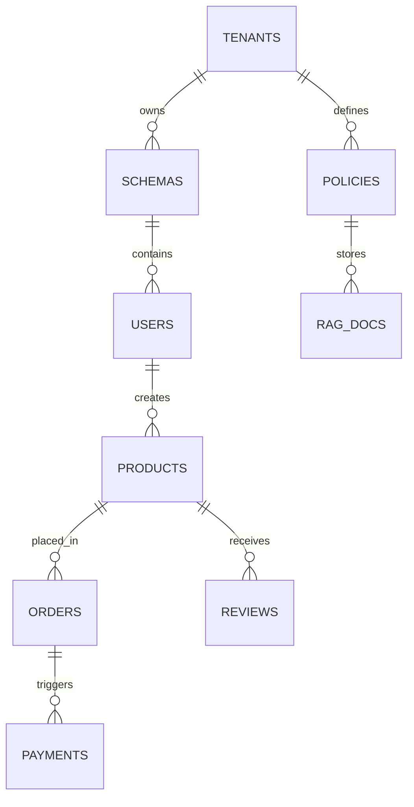

# System Design – Project‑AI (Detailed Documentation)

**Project:** Project‑AI
**Author:** Moustafa Maher
**Date:** 2026‑10‑21

---

## 1. Overview

Project‑AI is a **six‑member cross‑functional full‑stack & AI platform** that delivers a multilingual e‑commerce storefront with AI‑assisted operations, advanced analytics, and robust multi‑tenant security. The design below expands on the high‑level architecture captured in the *TechZone – Detailed Full‑Stack & AI Team Task Matrix* and provides exhaustive technical specifications for each pillar.

---

## 2. Goals & Scope

| Goal | Description |
|------|-------------|
| **Full‑Stack Vertical Slice** | Every team member owns a complete vertical slice (React UI, backend services, DB schema, AI agent, ML model) ensuring end‑to‑end ownership. |
| **Multi‑Tenant SaaS** | Supports up to 10 k concurrent tenants with isolated data via PostgreSQL Row‑Level Security (RLS). |
| **AI‑Driven Operations** | Automated store‑tenant provisioning, policy RAG assistant, and intelligent pricing via LLM‑driven agents. |
| **Data‑Science Enablement** | Forecasting, segmentation, and explainability built into the admin UI. |
| **Observability & Guardrails** | Prompt firewall, audit logging, Langfuse tracing, and SHAP explanations to meet compliance. |
| **Scalable Deployment** | Dockerised services, Helm charts, and auto‑scaling on Kubernetes. |

---

## 3. Stakeholders

- **Product Owner / Business** – Defines feature backlog and SLA requirements.
- **Front‑End Engineers (React)** – Build UI components, RTL support, and dashboards.
- **Back‑End Engineers (NestJS / FastAPI)** – Implement APIs, background jobs, and security.
- **Data Engineers** – Schema design, migration strategy, and RLS policies.
- **AI/ML Engineers** – LangGraph agents, LLM integration, forecasting models.
- **DevOps / Site Reliability** – CI/CD, monitoring, scaling, and disaster recovery.

---

## 4. Architecture Overview

```mermaid
flowchart LR
    subgraph FE[Frontend (React 18 + Vite)]
        FE_UI[UI Components]
        FE_State[State Management]
        FE_Charts[Recharts]
    end
    subgraph BE[Backend (NestJS + FastAPI)]
        BE_API[NestJS API Gateway]
        BE_Auth[Auth (Clerk/JWT)]
        BE_Jobs[BullMQ Workers]
        BE_AI[FastAPI LangGraph Service]
    end
    subgraph DB[Database (PostgreSQL + RLS)]
        DB_Core[Core Tables]
        DB_Tenant[Tenant Schemas]
        DB_Search[MeiliSearch Index]
    end
    subgraph AI[AI Agent (LangGraph + LLM)]
        AI_Graph[Slot‑Filling Graph]
        AI_LLM[Claude / GPT]
        AI_SQLGuard[sqlglot Guard]
    end
    subgraph ML[ML / Data Science]
        ML_Forecast[Prophet & LightGBM]
        ML_Segmentation[RF‑M + K‑Means]
        ML_Explain[SHAP Visuals]
        ML_Registry[MLflow]
    end
    subgraph Obs[Observability]
        Obs_Prom[Prometheus]
        Obs_Langfuse[Langfuse]
        Obs_ELK[ELK Stack]
    end

    FE_UI -->|REST/GraphQL| BE_API
    FE_State --> BE_API
    BE_API -->|Auth| BE_Auth
    BE_API -->|Job Queue| BE_Jobs
    BE_API -->|Data| DB_Core
    BE_Jobs -->|Async| DB_Core
    BE_API -->|AI Calls| BE_AI
    BE_AI --> AI_Graph --> AI_LLM
    AI_Graph -->|SQL Generation| AI_SQLGuard --> DB_Core
    BE_API -->|ML Predictions| ML_Forecast
    ML_Forecast --> DB_Core
    ML_Segmentation --> DB_Core
    ML_Explain --> FE_Charts
    Obs_Prom --> BE_API & BE_Jobs & AI_Graph & ML_Forecast
    Obs_Langfuse --> AI_Graph & BE_AI
    Obs_ELK --> BE_API & AI_Graph & ML_Forecast
```

---

## 5. Component Details

### 5.1 Front‑End (React 18 + Vite)
- **Entry point:** `src/main.tsx`
- **Routing:** React Router v6 with lazy‑loaded modules per vertical slice.
- **State:** Context API for tenant & auth; Redux Toolkit for complex grids.
- **Styling:** Tailwind CSS (JIT mode) with theme‑aware utilities.
- **Internationalisation:** `i18next` with RTL support; language files stored under `public/locales/`.
- **Testing:** Jest + React Testing Library (unit) + Cypress (E2E). Coverage target **≥90 %**.
- **Build:** Vite prod mode – code‑splitting, tree‑shaking, source‑maps disabled.

### 5.2 Back‑End (NestJS & FastAPI)
#### NestJS (API Gateway)
- **Structure:** Modular monorepo (`apps/api`, `libs/**`).
- **Controllers:** One per vertical slice (e.g., `store.controller.ts`).
- **Guards:** JWT Guard (`@UseGuards(JwtAuthGuard)`) with tenant extraction.
- **Validation:** `class-validator` with DTOs for request bodies.
- **Caching:** Redis (TTL = 60 s) for read‑heavy endpoints.
- **Documentation:** Swagger generated from decorators (`@ApiTags`).

#### FastAPI (AI Service)
- **Endpoints:** `/agents/{name}` for invoking LangGraph graphs, `/llm/chat` for direct LLM calls.
- **Dependency Injection:** `Depends(get_tenant)` to enforce RLS.
- **Security:** API key header validated against Vault secret.
- **Async Workers:** `fastapi[async]` with `uvicorn` workers (4‑core).

### 5.3 Database (PostgreSQL + RLS)
- **Version:** PostgreSQL 15 (Docker image `postgres:15-alpine`).
- **ORM:** Prisma for TypeScript (NestJS) and SQLAlchemy for Python (FastAPI).
- **Multi‑Tenant Model:**
  - `public.tenants` table stores metadata.
  - Each tenant gets a dedicated schema (`tenant_{id}`) created on provisioning.
  - RLS policies enforce `current_setting('app.tenant_id')` match.
- **Search Index:** MeiliSearch container syncs product tables via change‑data‑capture.
- **Backups:** Nightly `pg_dump` to S3 with point‑in‑time recovery enabled.

### 5.4 AI Agent (LangGraph)
- **Graph Definition:** `agent_graph.py` builds a directed acyclic graph of slots:
  1. **Collect Input** – tenant name, domain, branding.
  2. **Validate** – schema checks via `sqlglot`.
  3. **Provision** – creates DB schema, inserts baseline data.
  4. **RAG** – queries policy docs (vector store) for compliance.
- **LLM Providers:** Claude 3.5 Sonnet (default) with fallback to GPT‑4o.
- **Prompt Guardrail:** Middleware that scans prompts for PII and disallowed patterns.
- **Telemetry:** Langfuse traces (`trace_id`, `step_name`, `duration`).

### 5.5 ML / Data Science
- **Forecasting Service (`ml/forecast.py`):**
  - Input: historical sales JSON.
  - Model ensemble: Prophet (trend) + LightGBM (seasonality).
  - Output: `forecast` JSON with confidence intervals.
- **Segmentation Service (`ml/segment.py`):**
  - RFM calculation → K‑Means (k = 5) → cluster labels.
  - SHAP explainer attached to feature importance UI.
- **Model Registry:** MLflow tracking server (`mlflow:2.10`) with model versioning; models served via FastAPI endpoints.

### 5.6 Observability & Logging
- **Metrics:** Prometheus scrapes `/metrics` from all services; Grafana dashboards for latency, error rate, queue depth.
- **Tracing:** OpenTelemetry → Jaeger; LangGraph and FastAPI emit spans.
- **Logs:** Structured JSON → ELK stack; log level controlled via `ENV=production`.
- **Alerting:** PagerDuty alerts on SLA breaches (>200 ms avg API latency).

---

## 6. Data Model (ER Diagram)



*Key tables*:
- `tenants(id, name, created_at)`
- `users(id, tenant_id, email, role, password_hash)`
- `products(id, tenant_id, sku, name, price, metadata)`
- `orders(id, tenant_id, user_id, status, total, created_at)`
- `payments(id, order_id, provider, status, amount)`
- `policies(id, tenant_id, content, version)`

---

## 7. API Specification (Selected Endpoints)

| Method | Path | Description | Auth | Request Body |
|--------|------|-------------|------|--------------|
| `GET` | `/api/v1/tenants` | List all tenants (admin) | JWT (admin) | – |
| `POST` | `/api/v1/tenants` | Create new tenant (provisioning) | JWT (admin) | `{name, domain}` |
| `GET` | `/api/v1/products` | Search products (supports Meili filters) | JWT (tenant) | – |
| `POST` | `/api/v1/orders` | Submit new order | JWT (tenant) | `{items:[{productId, qty}]}` |
| `POST` | `/api/v1/ai/agent/{name}` | Run LangGraph agent (e.g., `create_store_tenant`) | API‑Key | `{payload}` |
| `GET` | `/api/v1/ml/forecast` | Get sales forecast for tenant | JWT (tenant) | `?period=30d` |
| `POST` | `/api/v1/ml/segment` | Trigger RFM segmentation job | JWT (admin) | `{tenantId}` |

*Full OpenAPI spec lives at `backend/openapi.yaml` and is served at `/api/docs`.*

---

## 8. Security & Compliance

- **Authentication:** Clerk for user management; JWT signed with RSA‑2048.
- **Authorization:** Role‑based access control (admin, manager, seller).
- **Data Isolation:** PostgreSQL RLS + per‑tenant schemas; tenant ID stored in `app.tenant_id` session variable.
- **Input Validation:** `class-validator` (NestJS) & Pydantic (FastAPI).
- **Secret Management:** HashiCorp Vault; secrets injected at runtime via `env_from` in Kubernetes.
- **GDPR / Data Retention:** Soft‑delete flags; automatic purge after 30 days for anonymised logs.
- **Audit Logging:** Immutable append‑only logs stored in S3 with WORM policy.
- **Pen‑Test:** Quarterly external security assessment; OWASP Top 10 mitigations applied.

---

## 9. Deployment Architecture

```mermaid
flowchart TB
    subgraph K8s[Kubernetes Cluster]
        direction LR
        Ingress[Ingress (NGINX)] --> Frontend[frontend‑svc]
        Frontend --> Backend[backend‑svc]
        Backend --> DB[postgres‑svc]
        Backend --> Redis[redis‑svc]
        Backend --> AI[ai‑svc]
        Backend --> ML[ml‑svc]
        Backend --> Obs[observability‑svc]
    end
    subgraph Infra[Infrastructure]
        DNS[Domain DNS]
        CDN[CDN (CloudFront)]
        Monitoring[Prometheus & Grafana]
        Logging[ELK]
    end
    DNS --> CDN --> Ingress
    Monitoring --> K8s
    Logging --> K8s
```

- **Namespaces:** `frontend`, `backend`, `ai`, `ml`, `monitoring`.
- **Helm Charts:** `project-ai-frontend`, `project-ai-backend`, `project-ai-ai`, `project-ai-ml`.
- **Auto‑Scaling:** HPA based on CPU (target = 60 %) and queue depth for workers.
- **Service Mesh:** Optional Istio for mutual TLS between services.

---

## 10. CI/CD Pipeline

1. **Pull Request Validation** – lint (`eslint`, `flake8`), unit tests, TypeScript type check.
2. **Build Stage** – Docker images built with `docker buildx`; tags `sha-${GITHUB_SHA}`.
3. **Publish** – Push images to private registry.
4. **Deploy** – GitHub Actions triggers Helm upgrade to `staging` environment.
5. **Smoke Tests** – Cypress runs against staging; if success, promote to `production`.
6. **Rollback** – If health checks fail, Helm rollback to previous release.

---

## 11. Scaling & Performance

- **Horizontal Scaling:** Stateless services (frontend, backend, AI, ML) scale out via replicas.
- **Database Sharding:** Future‑proof plan – shard tenants by hash of tenant ID across read replicas.
- **Cache Warm‑up:** Pre‑populate Redis with hot product data on tenant activation.
- **Latency Budgets:** < 200 ms for UI API calls; < 500 ms for AI agent responses.
- **Throughput:** Designed for 10 k RPS peak (burst) with 95 % percentile < 300 ms.

---

## 12. Testing Strategy

| Layer | Tool | Scope |
|-------|------|-------|
| Unit | Jest (JS/TS), pytest (Python) | Individual functions, models, helpers |
| Integration | Supertest (NestJS), FastAPI TestClient | API endpoint contracts, DB interactions |
| End‑to‑End | Cypress | Full user flows (store creation, checkout, AI assistant) |
| Load | k6 | Simulate 10 k concurrent users, measure latency |
| Security | OWASP ZAP | Automated scans for XSS, SQLi, auth bypass |
| AI/LLM | Custom prompt tests | Ensure guardrails block disallowed content |

All test suites run in CI; coverage report posted as artifact.

---

## 13. Operations & Maintenance

- **Runbooks:** Stored in `ops/runbooks/` (tenant provisioning, DB restore, AI service restart).
- **On‑Call Rotation:** PagerDuty schedule 24/7.
- **Versioning:** Semantic versioning for each service; Helm chart version aligns with Git tags.
- **Documentation Generation:** `mkdocs` builds site from `docs/` directory, deployed to GitHub Pages for internal reference.
- **Backup Validation:** Monthly restore drills from S3 snapshots.

---

## 14. Glossary

- **RLS:** Row‑Level Security – PostgreSQL feature enforcing per‑row access control.
- **LangGraph:** Framework for building LLM‑driven workflow graphs.
- **RAG:** Retrieval‑Augmented Generation – LLM generates output using retrieved documents.
- **TTL:** Time‑To‑Live – cache expiration period.
- **HPA:** Horizontal Pod Autoscaler – Kubernetes feature for scaling pods.

---

## 15. References

- **TechZone Task Matrix (HTML):** `Docs/techzone_light_detailed_full_stack_task_matrix.html`
- **LangGraph Docs:** https://langgraph.com/docs
- **MLflow Docs:** https://mlflow.org/docs
- **OpenAPI Spec:** `backend/openapi.yaml`
- **Prometheus Docs:** https://prometheus.io/docs/
- **Helm Charts:** `helm/` directory in repo

---

*End of Detailed System Design Document*